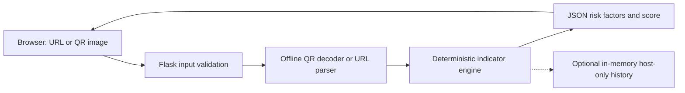

# Security architecture & limitations

## Data flow

**No step contacts the URL target.** CyberGuard does not resolve DNS, follow redirects, request certificates, or enrich results via third-party services. No remote fonts/CDN dependencies; static assets are served by Flask. Scanned input is not sent to ML or LLM providers.

## Defensive measures

- Validates absolute HTTP(S) schemes and domain labels, rejects URL credentials, control characters, invalid ports, and malformed hosts.
- Caps URL length at 2,048 characters and QR image bytes at 5 MiB, decoded pixel count at 8 million, and accepted formats to PNG/JPEG/WebP.
- Checks image signature/metadata rather than trusting file extensions or MIME types.
- Uses CSP, `nosniff`, frame denial, `no-referrer`, no external CORS, and `no-store` headers.
- UI uses `textContent` for untrusted values and has no inline JavaScript or remote assets.
- Does not persist uploaded images or URLs. Server history is **off** by default; opt-in history saves only hostname, level, score, and time in volatile worker memory.
- Configurable best-effort rate limiting per worker (40 requests per minute per direct remote address by default). This is **not** a replacement for proxy-level rate controls.
- HTTP error bodies do not include exception traces; production server uses non-root user with dropped Linux capabilities (Docker Compose configuration).

## Threat model

| Threat | Status | Residual risk |
| --- | --- | --- |
| SSRF via link scanning | Mitigated by architecture | URL target is never fetched, but URL parser could still have implementation bugs. |
| XSS from URL or QR payload | Escaped by DOM text nodes | Check all future UI code for unsanitized interpolation. |
| Decompression-bomb uploads | Byte, image-type and pixel caps | Highly crafted files can still stress native decoders; isolate workers and enforce CPU/memory limits in production. |
| Upload exhaustion / DoS | Byte caps, rate limits | Distributed sources or multiworker limits require gateway controls. |
| Sensitive URL leakage | Off by default history; no target fetching | A user's browser, server access proxies, or exported report may still reveal information; avoid logging bodies and treat exports as sensitive. |
| False positive / false negative phishing detections | Explicit disclaimer | Cannot confirm whether a URL is truly malicious without other sources and careful validation. |
| Unsafe public deployment | Bind to localhost by default | Public use requires TLS termination, robust rate limiting, monitoring, resource limits and security review. |

## Reporting security bugs

Avoid submitting real credentials, tokens, or sensitive URLs in public GitHub issues. Create a private GitHub security advisory or contact the repository maintainer through a private channel if available. Include a minimal non-sensitive reproduction.

## Operational boundaries

- `CYBERGUARD_HISTORY=1` retains **hostname-only** data for up to 30 scans in each worker. Multiworker containers show fragmented history.
- Browser session activity exists only in page memory and is lost upon refresh; it never sends session history to a storage service.
- Do not assert that HTTPS proves legitimacy or that a low score proves safety.
- A reverse proxy must provide HTTPS, upstream timeouts, body limits, real edge-rate limits, access control if needed, and sanitized logs.
- Dependencies have version ranges, not lockfile hashes. For long-lived production releases, resolve and pin exact versions, run vulnerability scans, and rebuild images regularly.
