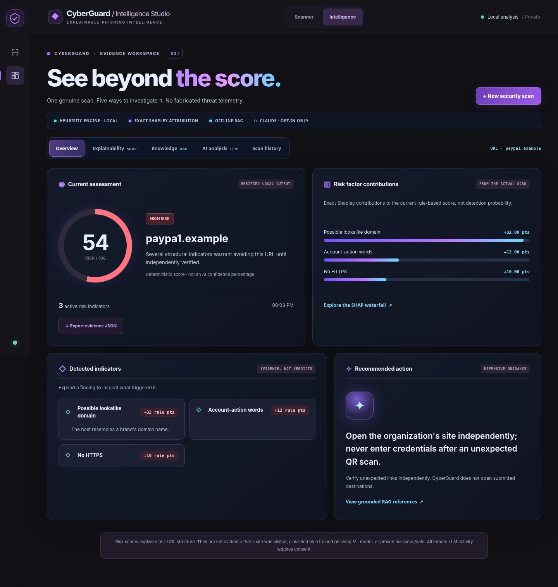
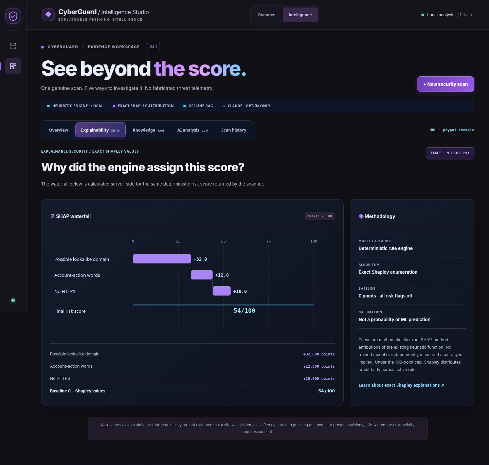
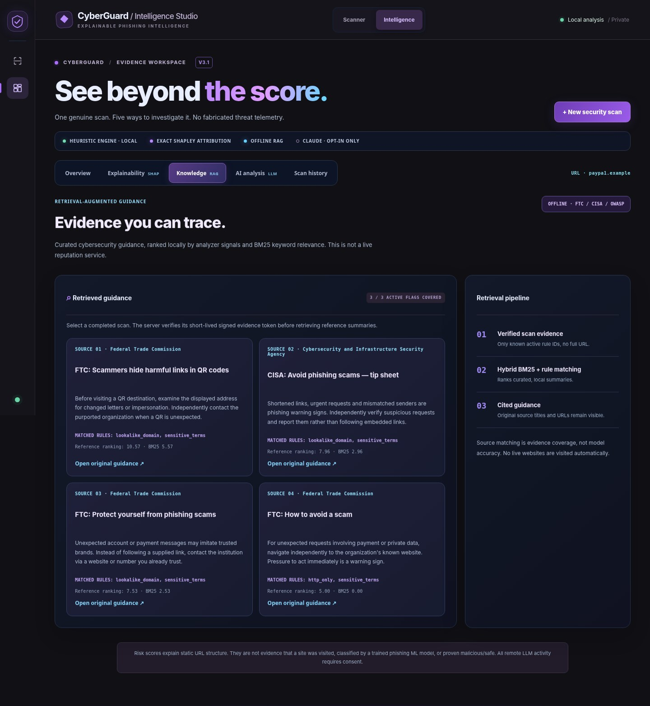
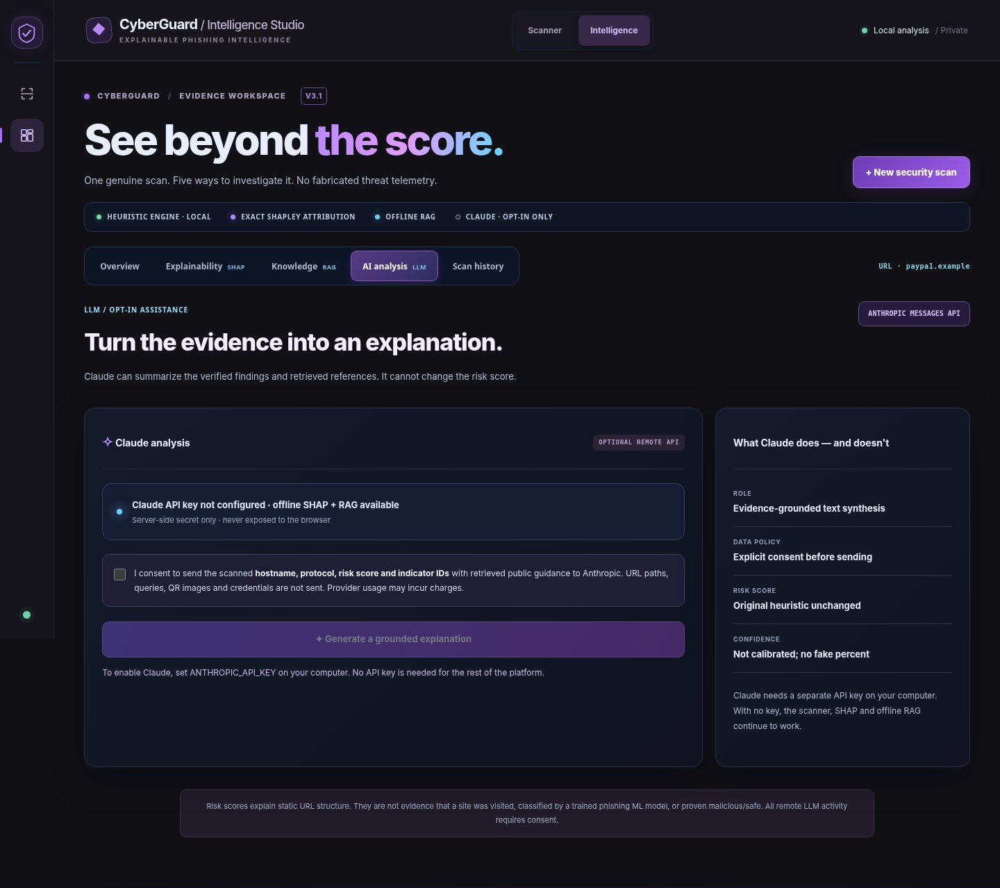
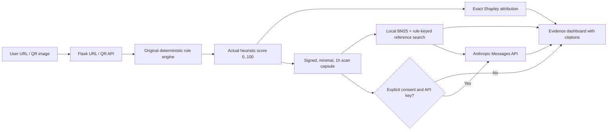

<div align="center">

# 🛡️ CyberGuard · Intelligence Studio

### Scan links. Explain every point. Retrieve grounded guidance.

**A privacy-conscious URL & QR security research prototype combining deterministic phishing heuristics, exact Shapley attribution, local hybrid RAG and optional, consent-gated Claude explanations.**

[](https://www.python.org/)
[](https://flask.palletsprojects.com/)
[](https://github.com/oull1i/CyberGuard/actions/workflows/ci.yml)
[](LICENSE)

</div>



*Real deterministic analysis of the **illustrative reserved test address** `http://paypa1.example/verify/password`. The 54/100 score and feature values are generated by the actual code, not a live threat feed or measured phishing probability.*

## What makes this project substantive?

| Capability | How it actually works | Claim boundary |
| --- | --- | --- |
| **URL + QR analysis** | Validates URLs or reads QR images, then evaluates 9 explainable structural indicators | Never fetches, follows or verifies a destination |
| **Exact SHAP / Shapley** | Enumerates the coalitions of active rule flags in Python, attributing the *actual clipped 0–100 heuristic score* | Explains the rule-based model; **not** a trained phishing classifier |
| **Grounded offline RAG** | Hybrid rule-ID matching + BM25 over curated FTC/CISA/OWASP summaries with source links | Not a vector database, embeddings service or live reputation check |
| **Claude API / LLM** | Uses Anthropic's Messages API to synthesize retrieved guidance and verified scan evidence | Requires a personal API key and **explicit consent**; cannot modify the score |
| **Security visuals** | Contribution bars, exact Shapley waterfall, session trend, findings, and citation cards built with local JS/SVG | No invented accuracy percentages or monitoring telemetry |
| **Privacy & safety** | CSP, strict upload limits, localhost by default, signed short-lived scan tokens, no third-party UI packages | A low score does not prove a destination is safe |

## Five clear analysis views

**Overview** — current score, top evidence contributions, findings and next step.

**Explainability** — exact Shapley waterfall for the rule score, baseline and additive totals.



**Knowledge RAG** — citations and source-linked summaries, with BM25 and rule matching signals.



**AI Analysis** — opt-in Anthropic Claude request (disabled until a valid API key is configured).



**Scan History** — real scans from the current browser tab, with a score timeline and export to JSON. Empty until you scan.

The QR hologram and scanning particle transition are visual effects, not a fake AI inference signal. The scanner remains a separate page at `/` and the studio is at `/dashboard`.

## Run it on Windows — one file

**Requirements:** Python 3.11+; first run needs internet to install dependencies. No Git, Node.js, SHAP pip install or Claude account is required for the offline experience.

1. Click **Code → Download ZIP** on this repository, and extract the folder.
2. Double-click **`RUN.bat`** (or open the folder in VS Code and run `./RUN.bat` in PowerShell).
3. Open **http://127.0.0.1:5000/**. Keep the server terminal open.

**Try two reserved, non-live test addresses as input text only:**

```text
https://example.com
http://paypa1.example/verify/password
```

Click **Analyze and open dashboard**, then explore the five tabs. For QR, upload a PNG/JPG/WebP image containing a URL QR code; images must be ≤5 MB. The application never opens the scanned URL.

### Optional: set up Claude

The original scanner, exact Shapley and offline RAG work without a key. Anthropic charges for API usage; a ChatGPT subscription does not provide an Anthropic API key.

1. Create an API key at **https://platform.claude.com/settings/keys**.
2. In PowerShell **inside the extracted project folder**, enter a key securely for the current terminal session:

```powershell
$secure = Read-Host 'Anthropic API key' -AsSecureString
$env:ANTHROPIC_API_KEY = [System.Net.NetworkCredential]::new('', $secure).Password
.\RUN.bat
```

3. Open **AI analysis** on the dashboard. Read and enable the checkbox **only if you agree** to send the scan hostname, protocol, rule IDs, score and public reference summaries to Anthropic. Click **Generate a grounded explanation**.
4. After shutting down Flask with Ctrl+C, clear your temporary key with `Remove-Item Env:ANTHROPIC_API_KEY`.

The key is never checked in, returned in API responses or stored by browser session history. **A real paid Claude API request requires your key; tests mock the provider and are not evidence of successful live provider integration.** The default model is configured via `CLAUDE_MODEL` (currently `claude-sonnet-4-6` unless overridden). Anthropic model availability is subject to change. If needed, set `ANTHROPIC_WORKSPACE_ID` as directed by the provider.

### Linux / macOS

```bash
python3 -m venv .venv
. .venv/bin/activate
python -m pip install -r requirements.txt
python app.py
```

## Architecture & data flow



No submitted destination is visited; references are opened only if the user clicks the official source link. The browser stores the hostname, score, short-lived signed token and indicators (not complete URLs or QR images) for up to 24 session records. The browser stores no provider API secret.

### Source files (minimal additions)

```text
app.py                     Flask API, adds Shapley explanation to scan results
analyzer.py                Original URL engine — unchanged
qr.py                      Original QR decoding — unchanged
explainability.py          Exact Shapley values for the existing score (stdlib)
security_knowledge.py      Curated citations + local hybrid BM25 retriever
ai_assistant.py            Signed evidence and consent-gated Claude integration
templates/index.html       Holographic scanner / live request transition
templates/dashboard.html   Five investigation tabs
static/styles.css          Cinematic English-first responsive design
static/app.js              Charts, accessible tabs, scan flow and AI UI
RUN.bat                    Single-click Windows launcher
tests/                     Engine, API, privacy, Shapley and RAG regression tests
```

### Selected API contracts

| Method | Endpoint | Function |
| --- | --- | --- |
| `POST` | `/api/analyze/url` | Existing URL evaluation; adds `result.explainability` |
| `POST` | `/api/analyze/qr` | QR decode → original evaluation → Shapley |
| `GET` | `/api/ai/status` | Key configured flag (never the key) |
| `POST` | `/api/ai/knowledge` | Source-backed offline RAG using signed scan token |
| `POST` | `/api/ai/assess` | Requires signed scan and `consent: true` |

Run tests locally after installing requirements: `python -m pip install pytest 'qrcode[pil]'` then `python -m pytest tests -q`. GitHub Actions runs tests on Python 3.11, 3.12 and 3.13 and checks JavaScript syntax.

## Methodology and limitations

- **SHAP precision:** these are *exact Shapley values* of the unchanged rule function, enumerated directly without the optional `shap` package. Baseline = 0 (all active warning flags removed), and `sum(SHAP values) + baseline = risk score`. Attribution fairly handles the 100-point cap. It is not learned feature importance or an ML confidence percentage. [SHAP Exact explainer background](https://shap.readthedocs.io/en/latest/example_notebooks/api_examples/explainers/Exact.html).
- **RAG precision:** curated summaries are not copied pages or freshly crawled articles. They have original official links. Retrieval is local rule matching + BM25 lexical ranking, not semantic embeddings or a vector database. Scores here rank *reference relevance*, not URL maliciousness.
- **Threat coverage:** CyberGuard cannot follow shortened links, inspect actual page behavior, determine hosting reputation, detect zero-day attacks or conclude a website is safe. It is a cybersecurity educational and portfolio tool, not a production anti-phishing product.
- **LLM confidence:** the model generates text, not calibrated risk probabilities, and its output is not proof of an attack. Avoid sharing sensitive hostnames if you do not consent to external processing.

### References and credits

- [FTC consumer QR code guidance](https://consumer.ftc.gov/consumer-alerts/2023/12/scammers-hide-harmful-links-qr-codes-steal-your-information)
- [FTC phishing guidance](https://consumer.ftc.gov/consumer-alerts/2025/04/protect-yourself-phishing-scams)
- [CISA phishing guidance](https://www.cisa.gov/sites/default/files/2024-09/Secure-Our-World-Phishing-Tip-Sheet.pdf)
- [OWASP unvalidated redirects](https://cheatsheetseries.owasp.org/cheatsheets/Unvalidated_Redirects_and_Forwards_Cheat_Sheet.html)
- [Anthropic Messages API](https://platform.claude.com/docs/en/api/messages/create)
- Design guidelines influenced by [UI/UX Pro Max](https://github.com/nextlevelbuilder/ui-ux-pro-max-skill) (MIT); **original source code** is CyberGuard's own frontend implementation.

**License:** MIT · See [LICENSE](LICENSE).
