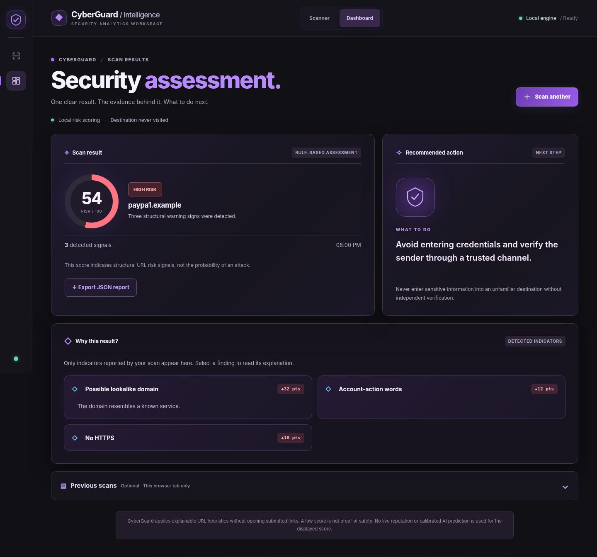
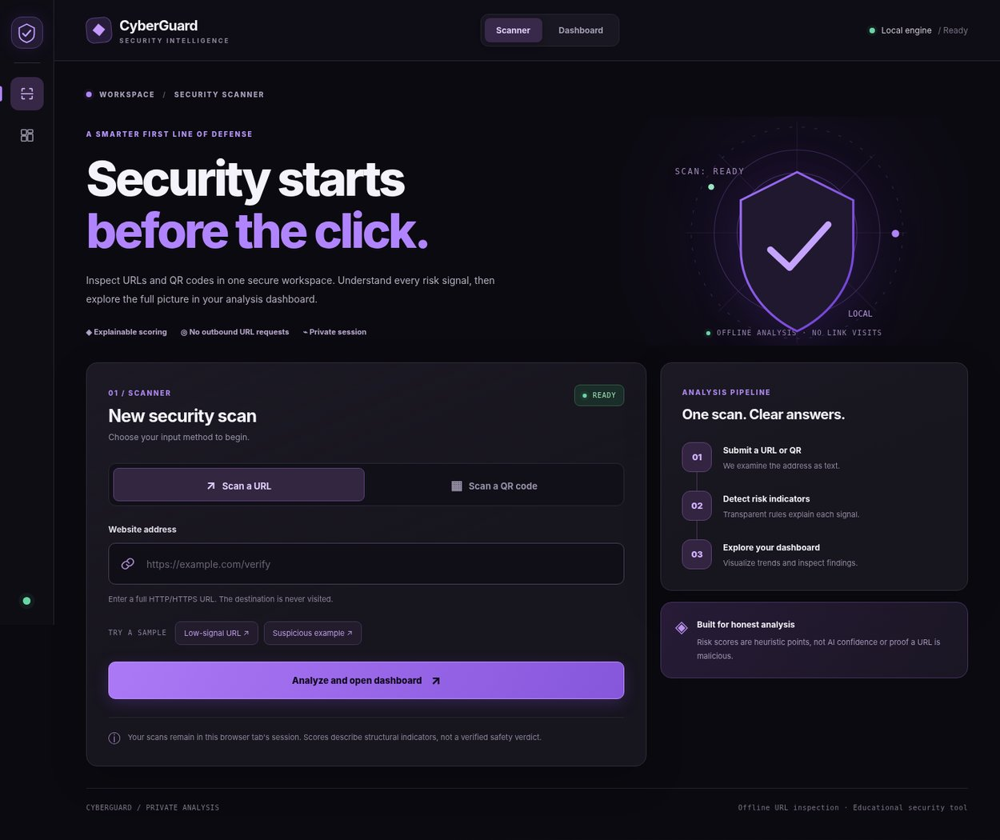
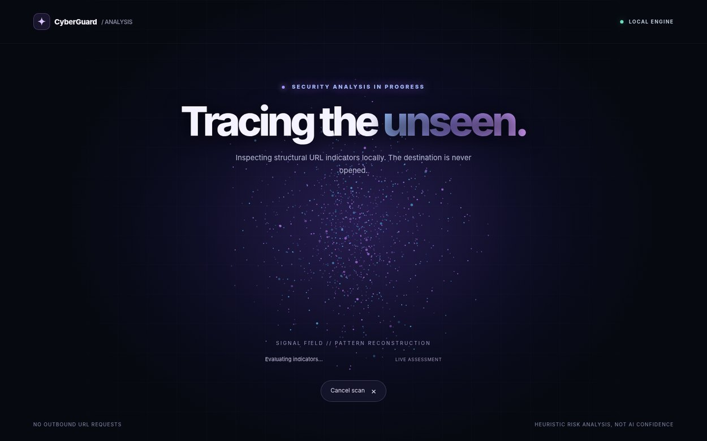

<div align="center">

# CyberGuard

### Scan links. Understand the risk. Take action.

**An explainable URL & QR security scanner with cinematic motion, offline reference-based RAG and optional opt-in Claude AI explanations.**

[](https://www.python.org/)
[](https://flask.palletsprojects.com/)
[](LICENSE)
[](https://github.com/oull1i/CyberGuard/actions/workflows/ci.yml)

</div>



*Dashboard captured using the example test URL `http://paypa1.example/verify/password`. The figures are from a test scan, not live threat intelligence.*

## The experience

| 01 · Scanner | 02 · Motion transition |
|:---:|:---:|
|  |  |

**1. Scan → 2. Visualize → 3. Investigate → 4. Optional evidence-grounded Claude explanation.** Enter a URL or upload a QR image. While the local API examines the input, an animated blue-violet particle field forms an orbital double helix. The animation has **no fabricated percent-complete indicator** and does not claim to represent a trained AI model. After the actual API result returns, you are taken to the **separate security dashboard**.

## Quick start — Windows / VS Code

**Prerequisite:** Python 3.11+ and internet access for the first install. No Git or Node.js required.

**Option A — simplest:** On GitHub, click **Code → Download ZIP**, extract the folder, then double-click **`RUN.bat`**. The Windows launcher creates `.venv`, installs dependencies and starts Flask.

**Option B — copy one PowerShell block** into **VS Code → Terminal → New Terminal**:

```powershell
$folder = Join-Path $HOME ('CyberGuard-' + (Get-Date -Format 'yyyyMMdd-HHmmss'))
New-Item -ItemType Directory -Path $folder | Out-Null
Invoke-WebRequest 'https://github.com/oull1i/CyberGuard/archive/refs/heads/main.zip' -OutFile "$folder\source.zip"
Expand-Archive "$folder\source.zip" -DestinationPath $folder
Set-Location "$folder\CyberGuard-main"
.\RUN.bat
```

When Flask starts, open **http://127.0.0.1:5000/**. Keep the terminal open; `Ctrl+C` stops the server.

Test with `http://paypa1.example/verify/password` (a reserved example domain) or `https://example.com`. Paste the address into the scanner; **do not open the example link in your browser**.

## Enable Claude AI (optional, separate provider account)

**All scanning and local RAG work without an API key.** Claude requires an Anthropic API account, an enabled/paid key and internet access. CyberGuard never stores an API key in frontend code, GitHub, session history or exported reports.

1. Create your personal API key at **https://platform.claude.com/settings/keys**. Provider billing may apply.
2. In **PowerShell**, inside the CyberGuard folder, use the following command to enter the key without echoing it on screen:

```powershell
$secure = Read-Host 'Enter your Anthropic API key' -AsSecureString
$env:ANTHROPIC_API_KEY = [System.Net.NetworkCredential]::new('', $secure).Password
.\RUN.bat
```

3. Scan any URL or QR using the normal Scanner. On the Dashboard, look for **CyberGuard AI Intelligence**. Offline RAG sources display automatically. To make a paid API call, **check the consent checkbox** and click **Ask Claude to explain this scan**.
4. `Ctrl+C` stops the server. To clear the temporary key from the terminal after stopping:

```powershell
Remove-Item Env:ANTHROPIC_API_KEY
```

The default model is `claude-sonnet-4-6` (configurable with the `CLAUDE_MODEL` environment variable). Provider availability and API pricing can change. For workspace-wide credentials, use `ANTHROPIC_WORKSPACE_ID` if Anthropic requires it.

### What leaves your computer — only after consent

A request to Anthropic contains a **hostname**, HTTP/HTTPS scheme, original heuristic risk score and classification, selected rule IDs, and short retrieved source summaries. **No full URL, path, query string or QR image is sent.** Hostnames may still reveal sensitive context, so opt in only for domains you are comfortable sharing. The destination website itself is never opened by CyberGuard. Refer to the [Claude API privacy/retention policy](https://platform.claude.com/docs/en/build-with-claude/api-and-data-retention) before opting in.

**Accuracy:** The model narrates evidence; it does not independently inspect the website or change the original local risk score. No calibrated AI confidence percentage is available. Displaying an invented confidence score would misrepresent the model's accuracy.

### How RAG works

`security_knowledge.py` implements **actual local retrieval**: it matches the analyzer's verified indicator IDs against short hand-curated reference summaries linked to the FTC, CISA and OWASP publications. The relevant excerpts are sent as grounded context if the user requests Claude. This is a small **offline rule-keyed RAG index**, not a vector database or a live threat feed. Original sources are displayed as clickable, inspectable references.

### API endpoints added

- `GET /api/ai/status` — whether the optional server-side Claude key is configured (never returns the key).
- `POST /api/ai/knowledge` — retrieve local guidance using a short-lived, signed scan token.
- `POST /api/ai/assess` — explicit `consent: true` and signed scan token required. Sends the minimum evidence to Anthropic, returns the model explanation with local source IDs. No URL fetching or AI probability predictions.

### macOS / Linux

```bash
python3 -m venv .venv
. .venv/bin/activate
python -m pip install -r requirements.txt
python app.py
```

## What it does

- **Two dedicated pages:** Scanner (`/`) and focused Security Results (`/dashboard`).
- **Explainable phishing indicators:** Looks for numeric IP hosts, lookalike domains, suspicious brand references, URL shorteners, punycode, deep subdomains, account-action wording, HTTP and unusual ports.
- **QR image decoding:** Validates and reads a single QR code from PNG, JPG or WebP, maximum 5 MB.
- **Motion design:** Responsive particle animation with indeterminate activity state, keyboard-accessible cancel button and reduced-motion support.
- **Focused results:** One genuine risk score, the affected hostname, detected indicators, a practical recommendation, and JSON export. Prior scans are accessible in an optional collapsed section.
- **Privacy by design:** No requests to submitted websites. Session history keeps a short-lived signed evidence token plus hostnames and scores, but not full URL paths or queries. Only explicit Claude consent triggers the outbound model API request. No trackers or external CDN dependencies.
- **RAG security evidence:** Retrieved official FTC/CISA/OWASP guidance is matched to active rule indicators, without fetching websites.
- **Optional Claude API:** User-initiated, consent-gated explanation with server-side credentials; it cannot overwrite scores or invent calibrated confidence.
- **Safety features:** Input validation, restrictive security headers, upload limits, rate limiting, HMAC-signed short-lived scan capsules and automated API tests.

## Architecture

```text
app.py                    Flask web server and REST API
analyzer.py               Offline URL parser + deterministic scoring
qr.py                     QR image decoding and validation
templates/index.html      Scanner screen + motion overlay
templates/dashboard.html  Post-scan security dashboard
static/app.js             Scanning interactions, particle renderer and charts
static/styles.css         Responsive visual system
RUN.bat                   One-click Windows startup
tests/test_app.py         Automated integration and security checks
security_knowledge.py     Locally retrieved FTC/CISA/OWASP guidance index
ai_assistant.py           Signed scan evidence, opt-in Claude HTTP client
tests/test_ai.py          RAG/AI API, privacy and consent tests
assets/                   Real browser screenshots (illustrative test scan)
```

### API

```text
GET  /api/health
GET  /api/ai/status
POST /api/ai/knowledge    JSON {"token":"<signed-scan-token>"}
POST /api/ai/assess       JSON {"token":"<signed-scan-token>","consent":true}
POST /api/analyze/url     application/json {"url":"https://example.com"}
POST /api/analyze/qr      multipart/form-data, field "image"
```

### Tests

```bash
python -m pip install pytest 'qrcode[pil]'
python -m pytest tests -q
```

GitHub Actions runs the test suite with Python 3.11, 3.12 and 3.13 on push or pull request.

## Important limitations

CyberGuard is a **defensive educational and portfolio project**. Its score is a sum of transparent heuristic points from 0–100; **it is not an AI confidence percentage, statistical probability, live reputation lookup or proof of maliciousness/safety. Optional Claude narratives are generative explanations, never a verified detection, and require explicit consent**. The analyzer does not follow links, detect zero-day vulnerabilities, resolve redirects or monitor external systems. Animation is visual feedback, not a representation of real network activity. The project starts on localhost; **GitHub hosts the source, not a publicly running Flask application**.

## Design credits

The dashboard's visual language was informed by [UI/UX Pro Max](https://github.com/nextlevelbuilder/ui-ux-pro-max-skill) (MIT) with a user-directed violet SOC aesthetic. See [STYLE_GUIDE.md](STYLE_GUIDE.md). The particle animation and UI implementation are original CyberGuard application code, not a bundled UI/UX Pro Max runtime.

## License

[MIT](LICENSE).

### Why the dashboard is intentionally minimal

The post-scan page shows only the selected scan, its actual risk indicators, a next-step recommendation and optional previous-scan history. Repeated severity summaries, charts, session statistics and the Claude card were removed from the **interface** to reduce distraction. The existing Claude/RAG **backend endpoints remain available** for future development, but the dashboard does not call them. AI requests are never sent from this dashboard.
