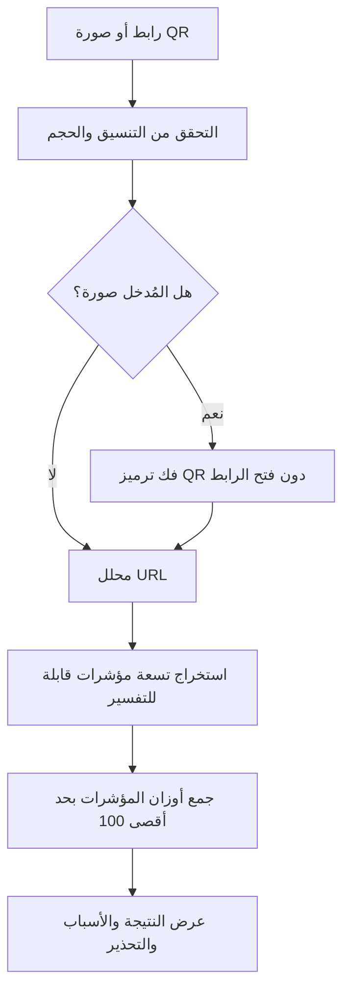

# CyberGuard Pro | شرح المشروع بالعربية

> **تنبيه علمي:** هذا المشروع يحلل **مؤشرات بنيوية** في الرابط أو رمز QR، ولا يزور الموقع ولا يستعلم عن سمعته. الدرجة من 100 هي **مجموع أوزان قواعد تفسيرية**، وليست نسبة ثقة بالذكاء الاصطناعي أو إثباتًا أن الرابط ضار/آمن.

## 1. فكرة المشروع

قد يؤدي مسح QR غير موثوق إلى فتح صفحة تحاول سرقة بيانات الدخول. بدل فتح الرابط مباشرة، يتيح CyberGuard للمستخدم لصق رابط أو رفع صورة QR لتحليل **بنية الرابط** والحصول على تفسير واضح للمؤشرات الموجودة فيه.

**المدخلات:** رابط يبدأ بـ `http://` أو `https://`، أو صورة PNG/JPEG/WebP لرمز QR يحوي رابطًا مدعومًا.

**المخرجات:** درجة خطورة تفسيرية من 0 إلى 100، ومستوى (`LOW` / `ELEVATED` / `HIGH`)، وقائمة بالمؤشرات التي أثرت في النتيجة وتوصية وقائية.

## 2. كيف يعمل؟



**التقنيات:** Python، Flask، OpenCV، Pillow، NumPy، JavaScript، HTML/CSS، pytest، Docker، GitHub Actions. توجد تجربة بحثية منفصلة لـ XGBoost/SHAP تتطلب بيانات مصنفة ولا تشغّل النموذج في المسار الأساسي.

## 3. مؤشرات الفحص

| المؤشر | ما المقصود به؟ | الوزن |
| --- | --- | ---: |
| IP host | اسم المضيف عنوان IP بدل نطاق مألوف | 23 |
| URL shortener | وجود نطاق خدمة اختصار معروفة | 20 |
| Brand impersonation | اسم علامة معروفة داخل نطاق غير تابع لها | 31 |
| Lookalike domain | اسم نطاق قريب بحرف واحد من أسماء مختارة | 32 |
| Punycode | وجود نطاق دولي مرمز بـ punycode | 12 |
| Deep subdomains | مستوى متداخل غير معتاد من النطاقات الفرعية | 11 |
| Sensitive terms | كلمات مثل login وreset وverify | 12 |
| HTTP only | رابط HTTP غير مشفر | 10 |
| Unusual port | منفذ غير شائع للتصفح | 8 |

الأوزان **اختيار هندسي توضيحي** وليست أوزانًا مستنتجة من بيانات اعتمادها إحصائيًا. كما أن وجود مؤشر واحد **لا يعني** وجود تصيد؛ وغيابه **لا يعني** سلامة الرابط.

## 4. مثال عملي آمن

أرسل الرابط الاختباري التالي عبر الواجهة أو الـAPI:

```text
http://paypa1.com/verify/password
```

يمكن للمحرك أن يشير إلى شبهة تشابه اسم النطاق مع `paypal`، وكلمات مرتبطة بالحساب، واستخدام HTTP. **لا تفتح الرابط** لغرض التجربة؛ التطبيق لا يحتاج إلى الاتصال بالموقع لمعرفة هذه المؤشرات. للاستعراض، استخدم نصوص الاختبارات الواردة في المستودع دون محاولة تسجيل الدخول لأي جهة.

## 5. لماذا اخترت هذه المعمارية؟

- **فصل المهام:** `analyzer.py` مستقل وقابل للاختبار، `qr.py` يتحقق من الصور ويفك QR، و`server.py` يربط النتائج بالـAPI.
- **تقليل المخاطر:** عدم الاتصال بعنوان الرابط يمنع نمطًا شائعًا من SSRF المرتبط بجلب الروابط.
- **الخصوصية:** عدم تخزين الروابط والصور على الخادم افتراضيًا؛ السجل الاختياري يحتفظ باسم المضيف وبعض البيانات الوصفية مؤقتًا في الذاكرة.
- **قابلية التوسع:** يمكن إضافة مصادر موثوقة للسمعة، ودعم اختبارات أقوى، وبناء نموذج تصنيف حقيقي بعد توفير بيانات موسومة.
- **الشفافية:** كل مؤشر يظهر بنقاطه، بدل إظهار ثقة زائفة لنموذج لم يتم تدريبه.

## 6. حدود المشروع بصراحة

1. لم تُثبت دقة الكشف على مجموعة بيانات مستقلة من الروابط الحقيقية.
2. المشروع لا يفحص محتوى صفحات الويب أو سمعة النطاقات أو التحويلات (redirects).
3. بعض المواقع السليمة قد تحصل على نقاط مرتفعة، والعكس صحيح.
4. سياسة حماية البيانات والبنية التحتية الإنتاجية تحتاج مراجعة أمنية قبل النشر العام على الإنترنت.
5. لا تعرض درجة الخطورة على أنها Accuracy أو AI confidence، ولا تصف النتائج الأساسية بأنها مبنية على XGBoost.

## 7. كيف تشرحه في مقابلة تقنية؟

**السؤال: ما المشكلة التي يحلها؟**  
يساعد المستخدم في فحص مؤشرات الاشتباه في روابط QR والروابط النصية بشكل محلي وقابل للتفسير قبل اتخاذ قرار زيارة الموقع.

**السؤال: لماذا لم تجعل السيرفر يفتح الرابط؟**  
لتقليل التعرض لمخاطر SSRF، والروابط الخبيثة، والتتبع الخارجي؛ محرك الفحص الحالي يكتفي بتحليل النص.

**السؤال: هل هو نموذج ذكاء اصطناعي؟**  
المحرك الأساسي قائم على قواعد واضحة، مع وحدة بحثية منفصلة لتجارب ML على بيانات مصنفة. لا أخلط نتائج القواعد بدرجات ثقة تعلم الآلة.

**السؤال: كيف تضمن جودة المشروع؟**  
قسمت الوحدات، أضفت اختبارات للمدخلات والنتائج والأخطاء، واستخدمت GitHub Actions لتشغيل الاختبارات عبر إصدارات Python متعددة وفحص Docker.

**السؤال: ماذا ستطور مستقبلًا؟**  
سأجمع بيانات موسومة بمصدر واضح، وأختبر تجنب تسرب نطاقات التدريب إلى الاختبار، ثم أقارن precision/recall وfalse-positive rate مع القواعد الحالية قبل دمج أي نموذج في التطبيق.

## 8. وصف مهني للسيرة الذاتية (English)

> Developed CyberGuard, a bilingual Flask-based QR and URL risk analysis application featuring explainable heuristic indicators, secure input validation, REST APIs, automated testing, Docker support, and GitHub Actions CI.

**مهارات يوضحها المشروع:** Python · Flask · URL Parsing · Defensive Programming · API Design · Threat Modeling · Secure File Handling · Automated Testing · Docker · CI/CD · Git/GitHub.

**ملفات مهمة:** [README](../README.md) · [API](API.md) · [النموذج الأمني](SECURITY.md) · [بحث تعلم الآلة](ML_RESEARCH.md) · [الرفع على GitHub](GITHUB_AR.md).
